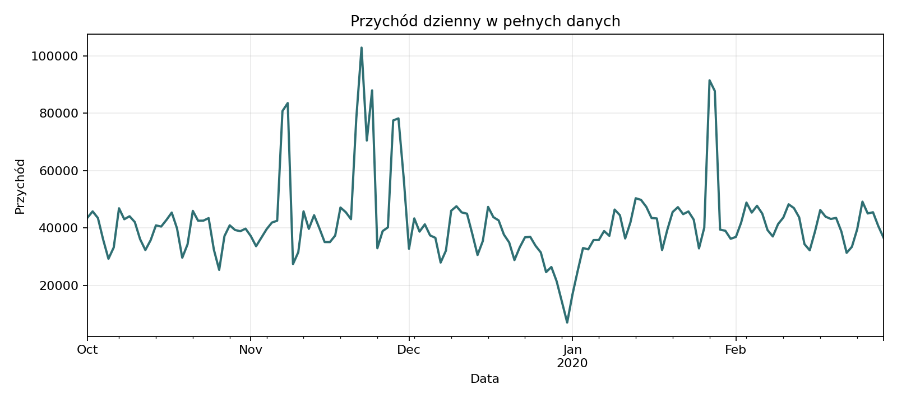

```{=html}
<section class="sl-hero" aria-labelledby="hero-heading">
  <div class="sl-hero-copy">
    <p class="sl-eyebrow">STORYLAB / PORTFOLIO ANALITYCZNE</p>
    <h1 id="hero-heading">Dane nabierają<br> <em>znaczenia.</em></h1>
    <p class="sl-lead">Historie o klientach, sporcie i gospodarce.<br> Od dobrego pytania do wniosków, które można sprawdzić.</p>
    <div class="sl-actions">
      <a class="sl-button" href="projects.qmd">Poznaj projekty <span aria-hidden="true">↗</span></a>
      <a class="sl-text-link" href="about.qmd#podejście-do-analizy">Podejście do analizy <span aria-hidden="true">→</span></a>
    </div>
    <p class="sl-hero-topics">Segmentacja klientów <span>·</span> Sport <span>·</span> Makroekonomia <span>·</span> Data storytelling</p>
  </div>
  <div class="sl-feature" aria-labelledby="feature-heading">
    <div class="sl-feature-label"><span>NA PIERWSZY PLAN</span><span>01 / E-COMMERCE</span></div>
    <p class="sl-big-number">43<span>%</span></p>
    <h2 id="feature-heading">przychodu pochodzi od<br> 10% kupujących.</h2>
    <p class="sl-feature-question">Co zmienia ta koncentracja w myśleniu o segmentacji klientów?</p>
    
    <div class="sl-feature-bottom"><span>Dane: październik 2019 — luty 2020</span><a href="stories/ecommerce_segmentation/business/executive-report.qmd">Czytaj analizę <span aria-hidden="true">→</span></a></div>
  </div>
</section>
<section class="sl-section-intro" aria-labelledby="selected-heading">
  <div><p class="sl-eyebrow">GŁÓWNE PROJEKTY</p><h2 id="selected-heading">Od pytania do pełnej analizy.</h2></div>
  <a class="sl-text-link" href="projects.qmd">Wszystkie projekty <span aria-hidden="true">→</span></a>
</section>
```

::: {#featured-projects}
:::

```{=html}
<section class="sl-section-intro sl-blog-intro" aria-labelledby="blog-heading">
  <div><p class="sl-eyebrow">Z BLOGA</p><h2 id="blog-heading">Ostatnio aktualizowane historie.</h2></div>
  <a class="sl-text-link" href="blog.qmd">Wszystkie wpisy →</a>
</section>
```

::: {#latest-stories}
:::


```{=html}
<section class="sl-principles" aria-labelledby="principles-heading">
  <div><p class="sl-eyebrow">JAK CZYTAĆ STORYLAB</p><h2 id="principles-heading">Za każdym wykresem<br> jest pytanie.</h2><a class="sl-text-link" href="about.qmd#podejście-do-analizy">Dane, metody, ograniczenia →</a></div>
  <div><span class="sl-step">01</span><h3>Najpierw kontekst</h3><p>Jaki problem rozwiązujemy i dla kogo odpowiedź ma znaczenie?</p></div>
  <div><span class="sl-step">02</span><h3>Potem dowody</h3><p>Źródła, definicje miar, wykresy i tabele dostępne w pełnych raportach.</p></div>
  <div><span class="sl-step">03</span><h3>Wreszcie interpretacja</h3><p>Wnioski oddzielone od hipotez i pytania, które pozostają otwarte.</p></div>
</section>
```
