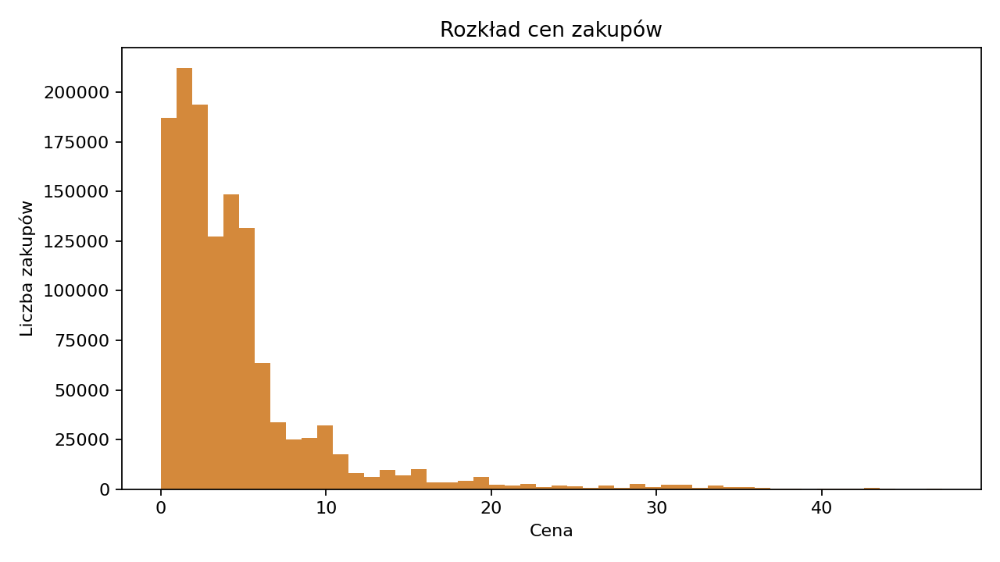

## Cel rozdziału

Ten rozdział odpowiada części EDA z klasycznego notebooka analitycznego. Jego zadaniem jest szybkie sprawdzenie, czy dane są kompletne, sensowne biznesowo i gotowe do dalszych analiz.

Quarto korzysta tutaj z lekkich artefaktów policzonych lokalnie na pełnym zbiorze kosmetycznym: **20 692 840 rekordów źródłowych**. Streamlit pozostaje wersją demonstracyjną, w której użytkownik wgrywa wyselekcjonowany mały plik CSV.

## Co ustaliliśmy w EDA

Najważniejsze ustalenia z pełnego zbioru kosmetycznego:

- po czyszczeniu technicznym zostaje 20,69 mln poprawnych zdarzeń,
- zdarzenia `purchase` stanowią 6,22% wszystkich eventów,
- zakup zrobiło 110,5 tys. z 1,64 mln użytkowników,
- braki w `category_code` ograniczają interpretację kategorii tekstowej,
- ceny zakupowe mają rozkład prawoskośny, dlatego w modelach stosowane jest logarytmowanie cech dodatnich.

## Liczba unikalnych wartości

Tak jak w notebooku, pierwszym krokiem jest sprawdzenie, jak bardzo rozdrobnione są identyfikatory produktów, kategorii, marek, klientów i sesji. Sama liczba produktów nie wystarcza do tezy o długim ogonie, ale pokazuje, że dalsza analiza powinna uwzględniać koncentrację sprzedaży i popularności.



## Metryki po czyszczeniu

Poniższe metryki pochodzą z pełnego zbioru kosmetycznego po czyszczeniu technicznym:



## Lejek od zdarzeń do przychodu

Pełny zbiór zaczyna się od **20,7 mln zdarzeń** i **1,64 mln użytkowników**. Po odfiltrowaniu realnych zakupów zostaje **1,29 mln pozycji zakupowych**, czyli **6,22% wszystkich zdarzeń**. Zakupu dokonało **110,5 tys. klientów**, czyli **6,74% wszystkich użytkowników**.

To zmienia sposób czytania dashboardu: nie analizujemy całej aktywności jako wartości biznesowej. Wyświetlenia i koszyki mówią o zainteresowaniu, ale przychód powstaje dopiero w małej grupie użytkowników, którzy kupują. Klient kupujący miał średnio **11,64 pozycji zakupowych** i wygenerował **57,47 jednostek wartości sprzedaży**.

{fig-alt="Wykres liniowy przedstawiający przychód dzienny w pełnym zbiorze kosmetycznym."}

## Produkty i marki

Najważniejsze marki według przychodu:



Tabela marek pokazuje, że ranking wolumenu i ranking wartości nie muszą być takie same. `runail` łączy największą liczbę zakupów z najwyższą wartością sprzedaży (**111 408 zakupów** i **343 433,19 wartości sprzedaży**), natomiast `strong` ma niski wolumen, ale wysoką wartość przychodu (**850 zakupów** i **151 941,80 wartości sprzedaży**). Top marki wolumenowe to `runail`, `irisk`, `masura`, `grattol` i `bpw_style`, a top marki przychodowe to `runail`, `grattol`, `irisk`, `uno` i `strong`. To sugeruje dwa różne zastosowania: marki wolumenowe są naturalnym punktem startu dla merchandisingu, a marki wysokowartościowe wymagają osobnej oceny marży i kosztu promocji.

Najważniejsze produkty według przychodu:



Interpretując ranking produktów i marek trzeba pamiętać, że `brand` ma istotne braki, a `category_code` jest prawie puste. Dlatego EDA dobrze opisuje widoczną część katalogu, ale nie wystarcza do pełnej segmentacji kategorii bez dodatkowego wzbogacenia danych.

## Rozkład cen

{fig-alt="Histogram cen zakupów w pełnym zbiorze kosmetycznym po czyszczeniu technicznym."}

Rozkład cen jest skośny: średnia cena pozycji zakupowej wynosi **4,93**, a mediana **3,00**. Dla wszystkich eventów P99 ceny wynosi **95,08** przy medianie **4,05**, dlatego w częściach segmentacyjnych stosowane jest logarytmowanie cech dodatnich przed standaryzacją i klasteryzacją.

## Interpretacja

EDA potwierdza, że dalsze analizy powinny traktować aktywność i wartość jako dwa różne zjawiska. Większość użytkowników nie kupuje, a sprzedaż powstaje w wąskiej grupie klientów. To uzasadnia osobne ścieżki: dashboard sprzedażowy, RFM dla kupujących i segmentację zachowań dla całej populacji użytkowników.
