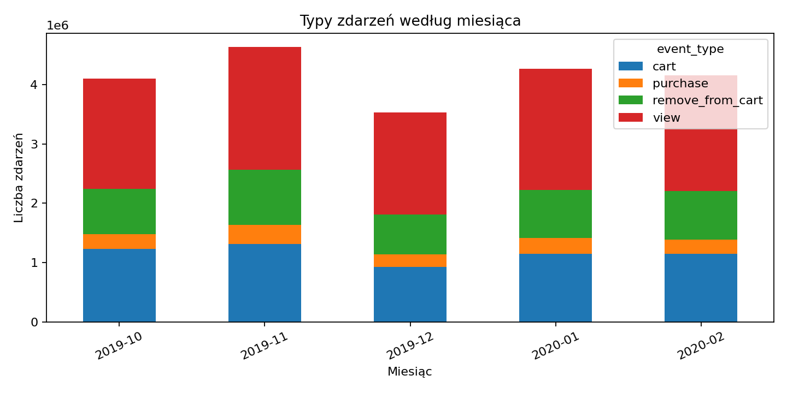
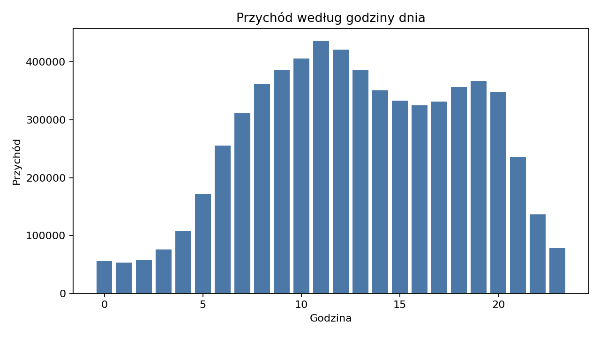
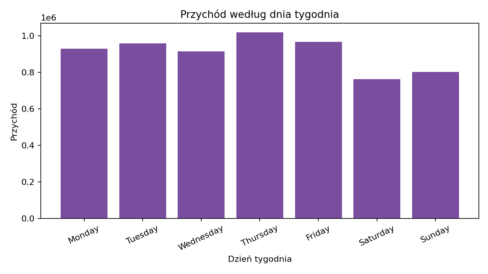
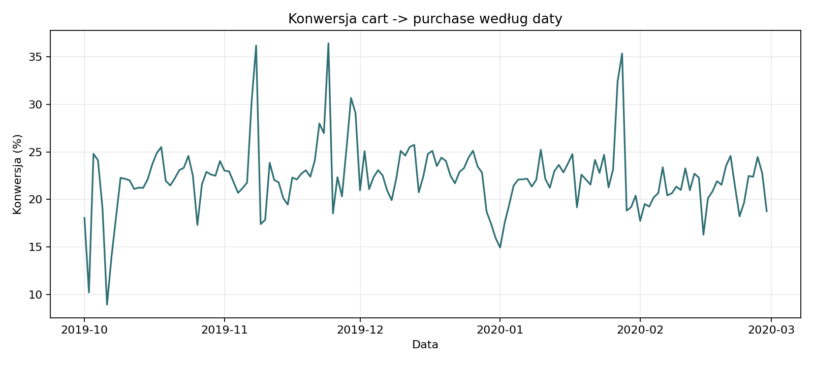
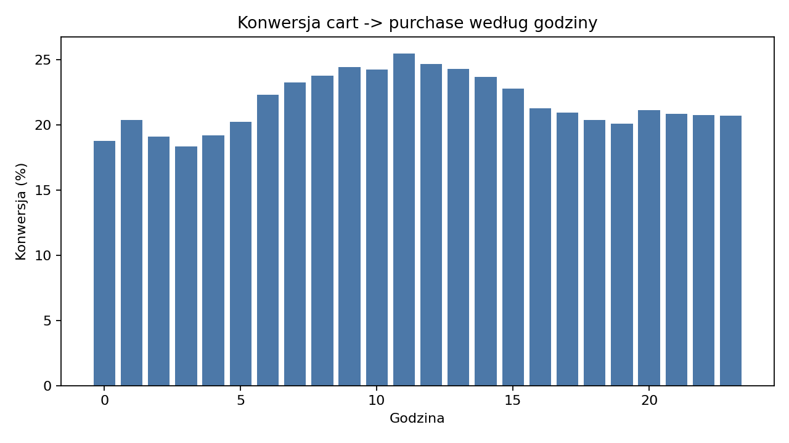

## Cel

Notebook referencyjny zwraca uwagę na wzorce zakupowe w czasie, w tym okresy promocyjne i świąteczne. W tym projekcie ta część oddziela ogólny dashboard od analizy sezonowości i rytmu zakupów.

## Pytania analityczne

W pełnej analizie sprawdzamy:

- w których miesiącach rośnie aktywność zakupowa,
- czy występują skoki wokół świąt, promocji lub końców miesiąca,
- w jakich godzinach użytkownicy najczęściej kupują,
- jak zmienia się konwersja z koszyka do zakupu,
- czy zachowania różnią się między kategoriami lub markami.

## Wyniki z pełnych danych

Liczba zdarzeń według miesiąca i typu:



{fig-alt="Skumulowany wykres słupkowy pokazujący typy zdarzeń według miesiąca."}

{fig-alt="Wykres słupkowy pokazujący przychód według godziny dnia."}

{fig-alt="Wykres słupkowy pokazujący przychód według dnia tygodnia."}

W pełnych danych rytm aktywności i rytm zakupów nie są identyczne: zdarzenia ogółem mają szczyt około 19:00, a zakupy około 11:00. Zakupy są też relatywnie silne w czwartek (**16,02% zakupów**), natomiast weekend ma łącznie **24,89% zakupów** i nie dominuje całego tygodnia. To wspiera ostrożną hipotezę, że komunikację zakupową warto testować osobno dla godzin przeglądania i godzin finalizacji transakcji.

## Konwersja cart -> purchase

Notebook źródłowy zwracał uwagę, że promocje mogą podnosić konwersję, a zakupy impulsywne mogą występować w godzinach nocnych. W tym raporcie traktuję to jako hipotezę do zestawienia z kalendarzem kampanii, a nie jako wynik przyczynowy. Dlatego oprócz liczby zdarzeń warto obserwować relację między dodaniem do koszyka i zakupem.

W tym raporcie wskaźnik `cart -> purchase` jest prostym wskaźnikiem zdarzeniowym:

$$
\frac{\text{liczba zdarzeń purchase w okresie}}{\text{liczba zdarzeń cart w okresie}}
$$

Nie jest to pełna konwersja sesji ani zamówień, ponieważ dane nie zawierają jednoznacznego identyfikatora zamówienia. Wersja produkcyjna powinna liczyć dodatkowo konwersję na poziomie `user_session`.

{fig-alt="Wykres liniowy pokazujący konwersję z koszyka do zakupu według daty."}

{fig-alt="Wykres słupkowy pokazujący konwersję z koszyka do zakupu według godziny dnia."}

Podsumowanie godzinowe:



Na poziomie całego zbioru relacja `purchase` do `cart` wynosi 22,31%, a `remove_from_cart` odpowiada za 68,99% liczby dodań do koszyka. To wskazuje na tarcie lub częste korekty koszyka, ale ponieważ wskaźnik jest ilorazem zdarzeń, nie dowodzi, że konkretna sesja przeszła od koszyka do zakupu.

Podobnie ostrożnie trzeba czytać sesje: mediana sesji ma tylko **1 event**, ale P99 ma **57 eventów**, a tylko **3,43% sesji** zawiera zakup. Większość sesji nie kończy się transakcją, więc analiza czasu powinna rozdzielać ogólną aktywność, korekty koszyka i realne zakupy.

## Interpretacja biznesowa

Analiza czasu pomaga planować:

- kalendarz kampanii,
- moment wysyłki komunikacji,
- promocje sezonowe,
- retencję po pierwszym zakupie, jeśli zostanie sprawdzona w osobnej analizie kohortowej.

Warto czytać te wykresy razem z kalendarzem kampanii. Skoki aktywności mogą wynikać z sezonowości, promocji, zmian w katalogu produktów albo różnej intensywności ruchu w sklepie.
