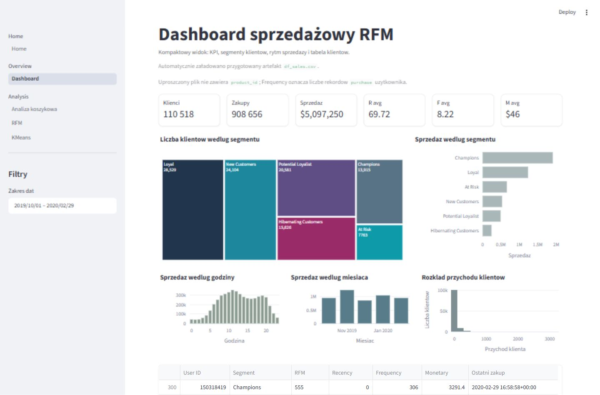
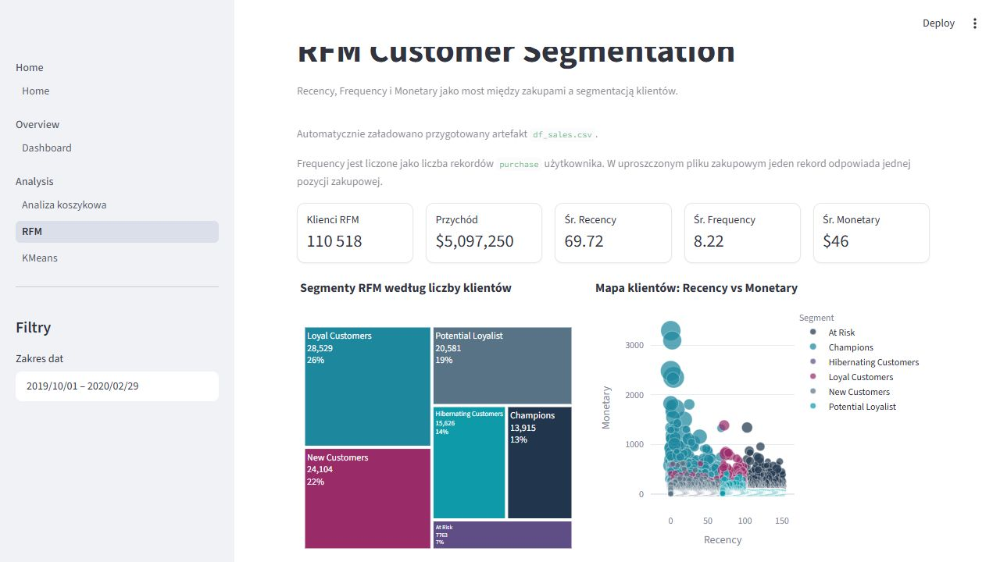
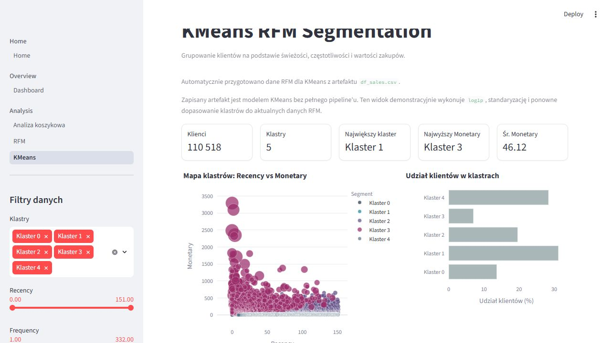
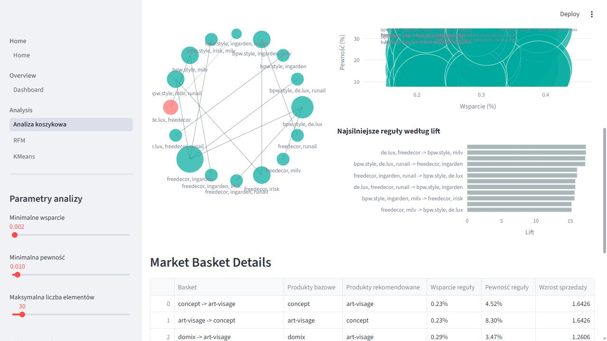

## Rola aplikacji

Streamlit jest interaktywną warstwą demonstracyjną case study. Pozwala przejść przez dashboard sprzedażowy, segmentację RFM, demonstracyjne grupowanie KMeans oraz analizę koszykową bez ponownego uruchamiania całego procesu wsadowego.

Quarto pozostaje raportem analitycznym i miejscem narracji: pokazuje, skąd biorą się wnioski, jakie są ograniczenia danych i jak wyniki przekładają się na rekomendacje. Aplikacja Streamlit służy do eksploracji tych samych artefaktów w bardziej operacyjnym widoku.

## Uruchomienie

::: {.callout-note}
Polecenia i ścieżki aplikacji na tej stronie dotyczą repozytorium
`marketing_data_app_gitea`. StoryLab przechowuje wersję publikacyjną raportu;
aplikacja, modele i pipeline pozostają w repozytorium źródłowym.
:::

Aplikację uruchamia się z lokalnego środowiska `.venv`:

```powershell
.\.venv\Scripts\python.exe -m streamlit run streamlit_start.py
```

## Dane wejściowe

Strona główna pozwala wgrać plik CSV albo użyć przygotowanego artefaktu:

```text
data/processed/df_sales.csv
```

Ten plik zasila dashboard, RFM i KMeans. Minimalny zestaw kolumn dla tych modułów to:

```text
event_time,event_type,price,user_id
```

Jeżeli dostępna jest kolumna `product_id`, Frequency może być interpretowane jako liczba kupionych pozycji lub produktów. W uproszczonym artefakcie `df_sales.csv` kolumna `product_id` nie jest wymagana, dlatego aplikacja liczy Frequency jako liczbę rekordów `purchase` użytkownika. To ograniczenie jest pokazywane bezpośrednio w widokach Dashboard i RFM.

Analiza koszykowa korzysta z osobnego artefaktu, ponieważ wymaga poziomu sesji i identyfikatora elementu koszyka:

```text
data/processed/basket_analysis_input.csv
```

Minimalny zestaw kolumn dla analizy koszykowej to:

```text
event_type,user_session,product_id
```

W praktyce aplikacja może też prowadzić analizę po `brand` albo `category_id`, jeżeli te kolumny są dostępne. Domyślny widok używa marek, bo jest czytelniejszy i szybszy w prezentacji niż pełna kardynalność `product_id`.

## Widoki aplikacji

Dashboard syntetyzuje sprzedaż, klientów i segmenty RFM w jednym ekranie. To widok do szybkiego omówienia skali bazy, wartości sprzedaży i udziału segmentów.

{fig-alt="Zrzut ekranu aplikacji Streamlit z dashboardem sprzedażowym RFM, metrykami klientów, sprzedaży oraz wykresami segmentów."}

Widok RFM pokazuje przejście od transakcji do interpretowalnych segmentów klientów. Obok metryk znajdują się treemap segmentów, mapa Recency vs Monetary oraz rozkłady cech RFM.

{fig-alt="Zrzut ekranu aplikacji Streamlit z analizą RFM, metrykami segmentów, treemapą i wykresem Recency vs Monetary."}

KMeans jest widokiem demonstracyjnym dla grupowania na cechach RFM. Aplikacja wykonuje transformację `log1p`, standaryzację i ponowne dopasowanie modelu do aktualnie użytych danych RFM.

{fig-alt="Zrzut ekranu aplikacji Streamlit z klasteryzacją KMeans, mapą klastrów, udziałem klientów i profilem cech."}

Analiza koszykowa pokazuje reguły asocjacyjne z koszyków zakupowych. Widok łączy KPI, sieć powiązań, mapę reguł, ranking lift oraz tabelę szczegółową.

{fig-alt="Zrzut ekranu aplikacji Streamlit z analizą koszykową, siecią powiązań, mapą reguł i tabelą Market Basket Details."}

## Znane różnice względem pełnego raportu

Model KMeans zapisany w repozytorium jest samym obiektem KMeans, a nie pełnym pipeline'em. Dlatego aplikacja nie jest produkcyjnym serwisem predykcyjnym: demonstracyjnie odtwarza transformacje i grupowanie na bieżącym artefakcie RFM. Wersja produkcyjna powinna zapisywać kompletny pipeline treningowy wraz z transformacjami.

Streamlit ładuje dane do pamięci, więc najlepiej traktować go jako narzędzie demonstracyjne i eksploracyjne. Pełne przeliczenia oraz artefakty raportowe pozostają po stronie skryptów wsadowych i Quarto.

## Przepływ prezentacji

1. Otworzyć Home i użyć przygotowanego artefaktu RFM/dashboard.
2. Przejść do Dashboardu i omówić metryki sprzedażowe oraz segmenty klientów.
3. Otworzyć RFM i pokazać, jak Recency, Frequency i Monetary prowadzą do segmentów biznesowych.
4. Otworzyć KMeans i porównać techniczne klastry z interpretacją RFM.
5. Otworzyć analizę koszykową, użyć przygotowanego artefaktu koszykowego i omówić reguły marek.
