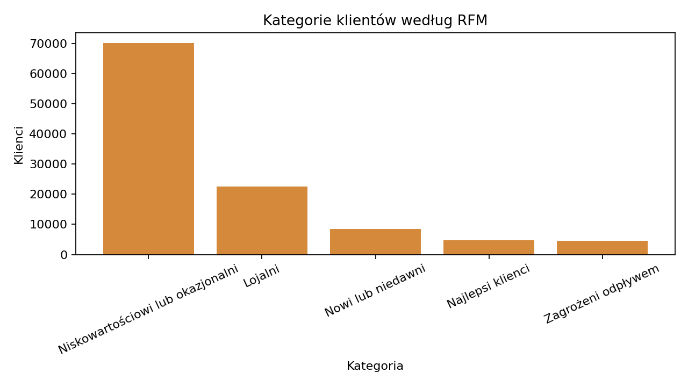
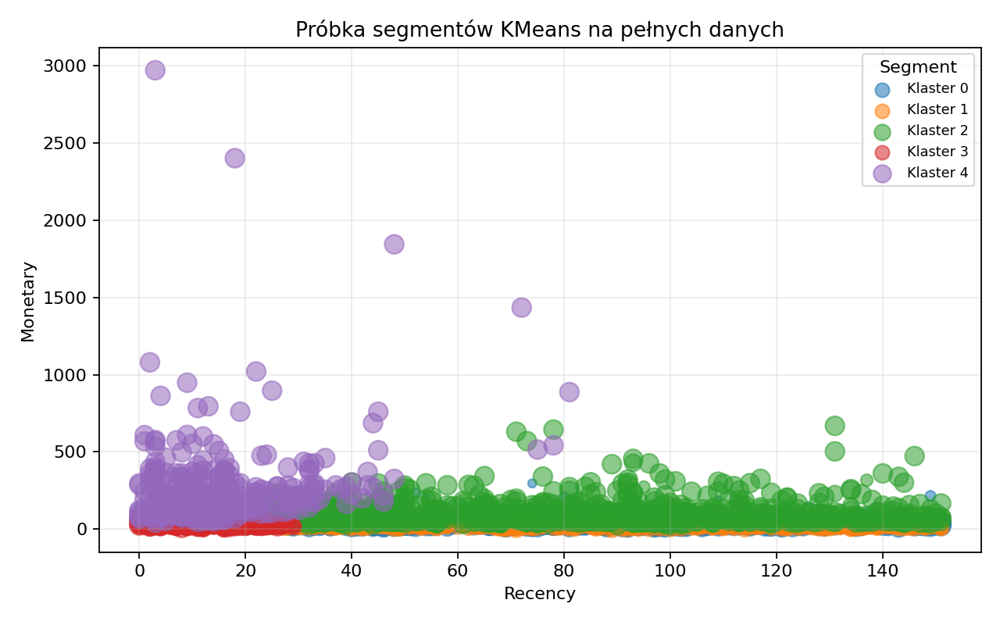
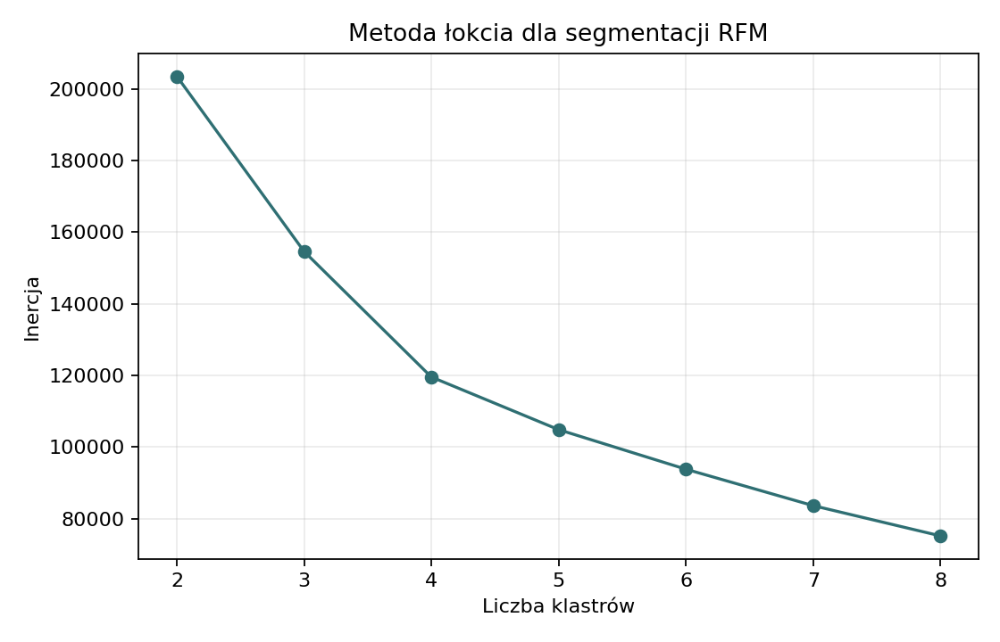
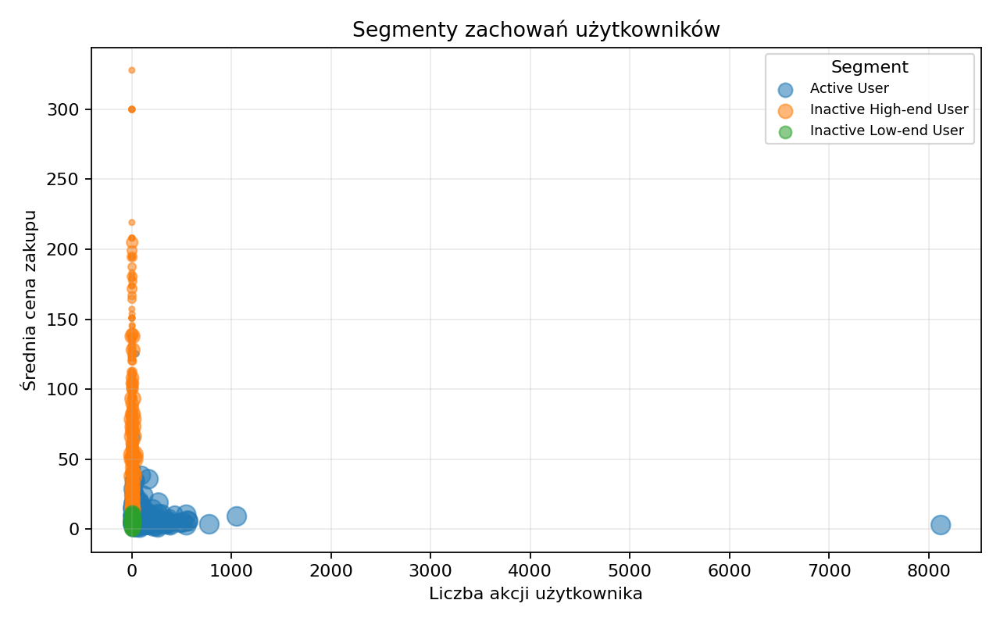

## Najpierw biznes: komu poświęcić uwagę?

Segmentacja jest potrzebna, bo klienci nie generują wartości równomiernie. W pełnych danych top 10% klientów kupujących odpowiada za 43,0% przychodu.



To uzasadnia osobne profilowanie kupujących, ale zawęża populację: RFM opisuje 110,5 tys. klientów z zakupem, a nie wszystkich 1,64 mln użytkowników aktywnych w danych.

## RFM: wartość zakupowa klienta

RFM sprowadza historię zakupów do trzech prostych cech: kiedy klient kupił ostatnio, jak często kupował i ile wydał.



{fig-alt="Wykres liczebności kategorii RFM."}

::: {.callout-tip collapse="true"}
### Technical details

- Dane wejściowe: wyłącznie zdarzenia `purchase`.
- Cechy: `recency` w dniach, `frequency` jako liczba pozycji zakupowych, `monetary` jako suma `price`.
- Dla modelowania KMeans cechy są transformowane przez `log1p` i skalowane.
- RFM jest bardziej interpretowalne biznesowo niż surowe eventy.
:::

## KMeans RFM: grupowanie podobnych profili

KMeans grupuje klientów o podobnym profilu RFM. W raporcie etykiety pozostają neutralne (`Klaster X`), a interpretacja wynika z profilu segmentu.



{fig-alt="Wykres punktowy segmentacji RFM."}

Interpretacja klastrów powinna wynikać z tabeli profili: liczebności, świeżości zakupu, liczby pozycji zakupowych i wartości `price`. Sam numer klastra jest techniczny i może zmienić się po ponownym treningu.

::: {.callout-tip collapse="true"}
### Technical details



{fig-alt="Wykres metody łokcia dla RFM."}
:::

## Segmentacja zachowań: aktywność poza zakupem

Drugi model patrzy szerzej niż RFM: bierze pod uwagę wszystkie zdarzenia użytkownika, nie tylko zakupy. Dzięki temu oddziela wartość zakupową od poziomu zaangażowania w platformę.



{fig-alt="Wykres segmentów zachowań użytkowników."}

Ten model opisuje zaangażowanie i poziom cenowy interakcji. Nie powinien być czytany jako bezpośrednia miara wartości klienta, bo obejmuje także użytkowników bez zakupu.

::: {.callout-tip collapse="true"}
### Technical details

- Cechy: średnia cena produktów z interakcji, liczba akcji, liczba sesji, średnia liczba akcji na sesję.
- Uwzględnione są wszystkie typy zdarzeń.
- Zastosowano `log1p`, `StandardScaler` i KMeans.
- Nazwa `avg_purchase_price` jest historyczna; w tym przepływie oznacza średnią cenę produktów, z którymi użytkownik wchodził w interakcję.


:::
