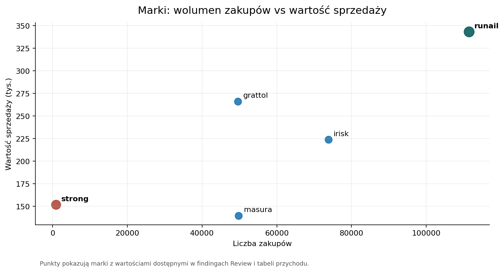

## Punkt wyjścia

W danych nie szukamy tylko ruchu w sklepie.

Szukamy odpowiedzi, **które zachowania tworzą wartość** i jak zamienić je w testowalne działania marketingowe.

## Skala

- **20,7 mln** zdarzeń
- **1,64 mln** użytkowników
- **4,54 mln** sesji
- okres: **2019-10-01 -- 2020-02-29**

To jest pełny zbiór kosmetyczny, więc raport oddziela ogólną aktywność od wartości sprzedażowej.

## Najpierw filtrujemy wartość

{fig-alt="Skumulowany wykres słupkowy pokazujący typy zdarzeń według miesiąca."}

Zakupy to tylko **6,22% wszystkich zdarzeń**.

Pozostała aktywność mówi o zainteresowaniu, koszyku i korektach, ale przychód liczymy wyłącznie na `purchase`.

## Przychód jest skoncentrowany

{fig-alt="Wykres liniowy przychodu dziennego w pełnym zbiorze kosmetycznym."}

**110,5 tys. kupujących** wygenerowało **6,35 mln** wartości sprzedaży.

## Kluczowy wniosek

```{=html}
<div class="revenue-steps" aria-label="Koncentracja przychodu: top 10 procent i top 20 procent kupujących">
  <div class="revenue-step revenue-step-small">
    <div class="step-label">Top 10%</div>
    <div class="step-body">43% przychodu</div>
  </div>
  <div class="revenue-step revenue-step-large">
    <div class="step-label">Top 20%</div>
    <div class="step-body">59% przychodu</div>
  </div>
</div>
```

Wraz z rozszerzeniem grupy z **10%** do **20%** kupujących obejmujemy **43% -> 59%** przychodu.

**Wniosek:** rekomendacje nie powinny traktować całej bazy tak samo.

## Ceny mają długi ogon

{fig-alt="Histogram cen zakupów w pełnym zbiorze kosmetycznym."}

Mediana ceny zakupu to **3,00**, a średnia **4,93**.

Dlatego cechy wartościowe wymagają transformacji przed modelowaniem.

## RFM porządkuje kupujących

RFM opisuje klientów przez:

- świeżość ostatniego zakupu,
- liczbę pozycji zakupowych,
- sumę wartości `price`.

To model dla **kupujących**, nie dla wszystkich użytkowników.

## Pierwszy model: KMeans na RFM

{fig-alt="Wykres punktowy segmentacji RFM."}

Pierwszy model grupuje kupujących według świeżości, częstotliwości i wartości zakupów.

Pięć klastrów ma porównywalną skalę: najmniejszy obejmuje **10,69%** kupujących, a pozostałe około **19-24%**.

## Od klastra do profilu klienta

Numer klastra, np. `Klaster 0`, jest tylko etykietą techniczną.

Znaczenie biznesowe pojawia się dopiero po odczytaniu profilu: świeżości, liczby pozycji zakupowych, wartości sprzedaży i udziału w przychodzie.

## Drugi model: aktywność użytkowników

{fig-alt="Wykres segmentów zachowań użytkowników."}

Drugi model nie zaczyna od RFM. Grupuje wszystkich użytkowników według liczby akcji, liczby sesji i poziomu cenowego interakcji.

Jeden segment obejmuje **58,55%** użytkowników, więc najpierw interpretujemy skalę i aktywność, a dopiero potem hipotezy ofertowe.

## Gdzie użytkownicy rezygnują

Relacja `purchase/cart` wynosi **22,31%**.

`remove_from_cart` odpowiada za **68,99%** liczby dodań do koszyka.

Dużo zdarzeń kończy się na koszyku lub usunięciu z koszyka, więc warto sprawdzić, gdzie użytkownicy rezygnują przed zakupem.

## Konwersja wymaga ostrożności

{fig-alt="Wykres liniowy pokazujący relację purchase do cart według daty."}

To nie jest pełny funnel zamówienia.

Wskaźnik porównuje liczby zdarzeń, a nie śledzi jednej konkretnej sesji od koszyka do zakupu.

## Rytm zakupów jest inny niż rytm ruchu

{fig-alt="Wykres słupkowy pokazujący przychód według godziny dnia."}

Zdarzenia ogółem mają szczyt około **19:00**, a zakupy około **11:00**.

To sugeruje osobne testowanie komunikacji dla przeglądania i finalizacji zakupu.

## Cross-sell zaczyna się od marek

Reguły asocjacyjne wskazują `runail` jako częsty element koszyka po zakupach marek takich jak `irisk`, `grattol`, `ingarden` i `bpw_style`.

Ograniczenie: `brand` ma **42,32%** braków, więc reguły opisują tylko rozpoznaną część katalogu.

## Marki mają różne role

{fig-alt="Wykres punktowy pokazujący marki według liczby zakupów i wartości sprzedaży."}

`runail` łączy największy wolumen i przychód, a `strong` ma niski wolumen przy wysokiej wartości sprzedaży.

## Co rekomendować

1. Chronić klientów wysokowartościowych.
2. Rozwijać kolejny zakup przez cross-sell.
3. Oddzielnie testować aktywizację nowych kupujących.
4. Finansować reaktywację ostrożnie.
5. Mierzyć efekt po zakupach, przychodzie i retencji.

## Co musi zostać hipotezą

Dane opisują przychód, nie zysk.

Brakuje marży, kosztów kampanii, efektów A/B i jednoznacznego identyfikatora zamówienia.

## Jak czytać wynik

To case study prowadzi od danych, przez wyniki i segmenty, do rekomendacji wymagających walidacji.

Najważniejsza decyzja nie brzmi: "komu wysłać kampanię?", tylko: **które hipotezy warto najpierw przetestować**.

## Powrót do raportu

[Otwórz raport Quarto](index.html){.deck-return-button}
