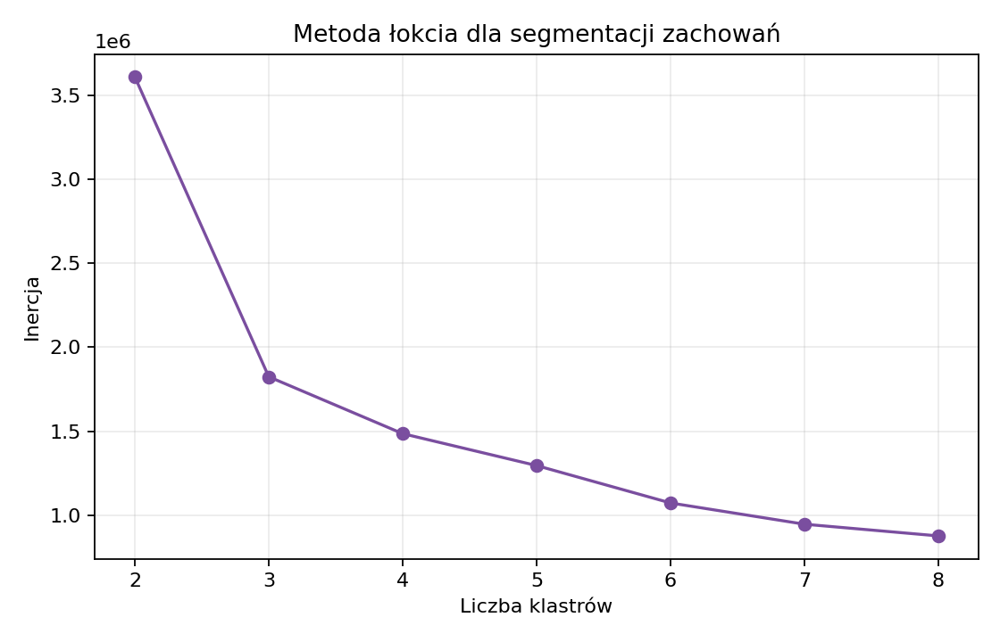

## Jakość danych





## Transformacje

W analizie rozdzielono zdarzenia zakupowe od pozostałych eventów. Przychód, RFM i koszyk zakupowy są liczone na `purchase`; segmentacja zachowań korzysta z pełnej aktywności użytkownika.

W RFM `Recency` jest liczone w dniach względem ostatniego zakupu w oczyszczonym okresie obserwacji. `Frequency` oznacza liczbę pozycji zakupowych, nie liczbę zamówień.

Wskaźnik `cart -> purchase` w rozdziale czasowym jest wskaźnikiem zdarzeniowym: liczba zdarzeń `purchase` podzielona przez liczbę zdarzeń `cart` w danym okresie. Nie zastępuje konwersji sesji.

::: {.callout-tip collapse="true"}
### Logarytmowanie i skalowanie

Cechy `frequency`, `monetary`, liczba akcji i liczba sesji są skośne. Dlatego przed KMeans stosowane jest `log1p`, a następnie `StandardScaler`.
:::

## Dobór liczby klastrów

RFM:



{fig-alt="Metoda łokcia dla KMeans RFM."}

Segmentacja zachowań:



{fig-alt="Metoda łokcia dla segmentacji zachowań."}

## Parametry i ograniczenia

- Dane pełne pozostają poza Gitem.
- Artefakty raportu są lekkimi wynikami `.md`, `.csv` i `.png`.
- Model KMeans w `models/` jest świadomym wyjątkiem, bo jest mały.
- Zapisany artefakt KMeans jest samym modelem, nie pełnym pipeline'em ze scalerem. Streamlit stosuje transformację demonstracyjną i ponownie grupuje aktualnie wgrane dane, a docelowo warto zapisać pipeline obejmujący `log1p`, `StandardScaler` i KMeans.
- Brak marży uniemożliwia mówienie o zysku.
- `category_code` ma 98,29% braków, więc bez imputacji lub walidacji jest prawie nieużywalne jako cecha modelowa.
- `brand` ma 42,32% braków, więc analiza marek opisuje tylko rozpoznaną część katalogu.
- Ceny zawierają 131 wartości ujemnych i 104 157 wartości zerowych; dodatkowo P99 ceny dla wszystkich eventów wynosi 95,08 przy medianie 4,05, więc cechy pieniężne wymagają czyszczenia i transformacji odpornych na ogon rozkładu.

## Demo i odtwarzanie artefaktów

Repozytorium zawiera plik demonstracyjny:

```text
data/demo/sample_sales.csv
```

Demo jest małe i służy do pokazania przepływu w Streamlit. Pełne wyniki raportu Quarto są liczone lokalnie na zbiorze kosmetycznym, a następnie zapisywane jako lekkie tabele i wykresy:

```text
analysis/full_tables/
analysis/full_figures/
```

Artefakty pełnej analizy można odtworzyć komendą:

```powershell
.\.venv\Scripts\python.exe scripts\build_full_analysis_artifacts.py
```

Artefakty demonstracyjne można odtworzyć komendą:

```powershell
.\.venv\Scripts\python.exe scripts\build_portfolio_artifacts.py
```

Poza repozytorium powinny zostać pełne miesięczne CSV, duże zbiory przetworzone, lokalne outputy badawcze, notebooki robocze z ciężkimi wynikami oraz `.venv`.

## Pełna tabela KMeans RFM


