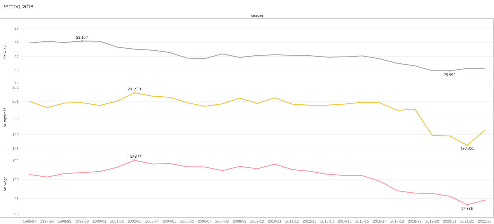
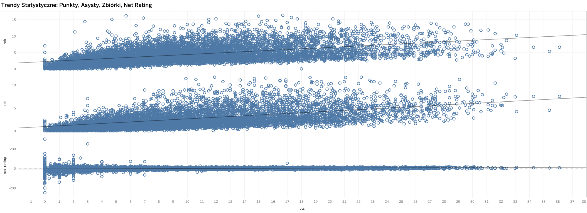
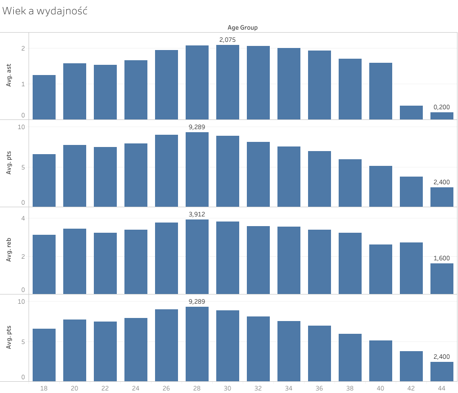
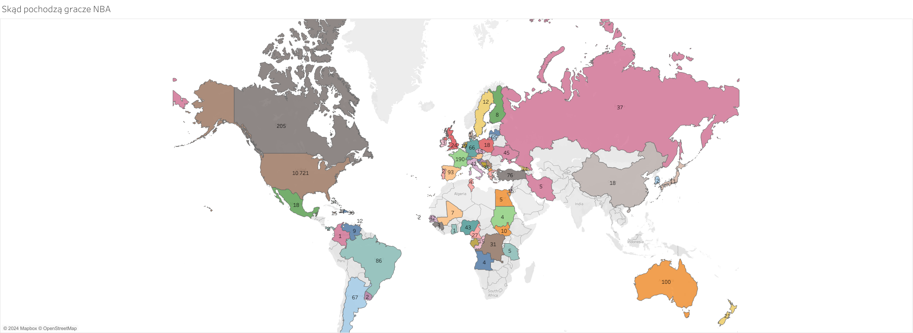
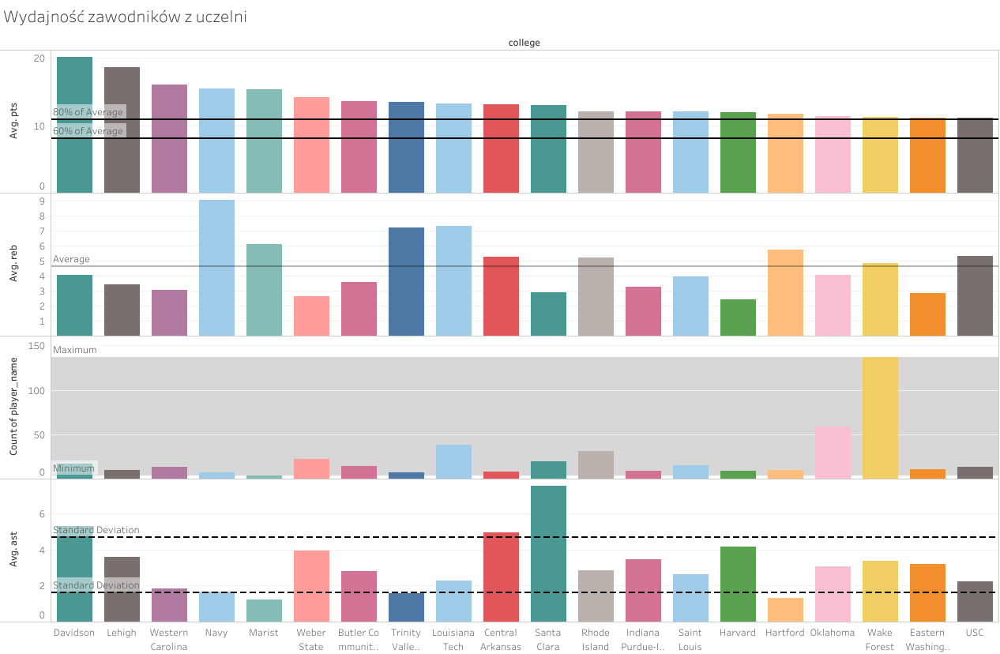

::: {.callout-tip appearance="simple"}
**Rozdziały projektu:** [Start](index.qmd) | **Historia** | [Metodologia](methodology.qmd) | [Warsztat](portfolio.qmd) | [Dalszy rozwój](roadmap.qmd)
:::

## Pytanie projektu

Co sprawia, że zawodnik NBA się rozwija i odnosi sukces? Jak wyglądają typowe profile fizyczne najlepszych graczy i skąd pochodzą? I co z tych wzorców może realnie pomóc scoutowi przed draftem?

To pierwsza wersja raportu nie daje jeszcze pełnych odpowiedzi, ale pokazuje najważniejsze trendy: jak zmieniała się liga, kiedy zawodnicy osiągają najlepsze wyniki i gdzie warto szukać dalszych wskazówek.

## Pobierz raport

- [Wersja HTML](story.html)
- [Archiwalny raport PDF](archive/analiza_nba_JF.pdf)

PDF dokumentuje wcześniejszą analizę; aktualna narracja jest dostępna na tej stronie.

## Najważniejsze wnioski

- NBA w ostatnich dekadach stała się młodsza, niższa i lżejsza.  
- Gracze zdobywają coraz więcej punktów i notują więcej asyst.  
- Najlepsze wyniki osiągają zawodnicy przed trzydziestką, a nie na początku kariery.  
- Coraz więcej talentów trafia do NBA z różnych krajów i uczelni, ale sama geografia niewiele mówi o ich przyszłym sukcesie.  
- Dla scouta płynie z tego ważna lekcja: pojedyncza cecha (np. wzrost czy kraj pochodzenia) nie wystarczy do dobrej decyzji bez szerszego kontekstu kariery.  

## Liga się zmienia

Pierwszy wykres pokazuje, jak zmieniała się demografia zawodników NBA w ostatnich 27 sezonach. Średni wiek spadł z około 28 do 26 lat, a zawodnicy są dziś niżsi i lżejsi.

[{width=100%}](archive/demografia.png)

*Liga staje się młodsza, lżejsza i nieco niższa, co dobrze wpisuje się w zmianę stylu gry.*

::: {.callout-note collapse="true"}
## Jak czytać wykres
Oś X przedstawia sezony NBA od `1996-97` do `2022-23`.

Oś Y pokazuje kolejno średni wiek, średni wzrost i średnią wagę zawodników w danym sezonie.

Jednostką analizy jest sezon ligowy.
:::

Nie oznacza to jednak, że gracze są słabsi. Zmienił się raczej styl gry — dziś większe znaczenie mają mobilność, szybkość i wszechstronność niż sama siła i warunki fizyczne.

Dla scouta to ważna wskazówka: podejście „im większy, tym lepszy” nie działa tak dobrze jak kiedyś.

## Więcej punktów, więcej kreowania gry

Drugi wykres pokazuje, jak liczba punktów wiąże się z innymi statystykami — zbiórkami, asystami i net ratingiem.

[{width=100%}](archive/trendy_gry.png)

*Więcej zdobyczy punktowych zwykle idzie w parze z większą liczbą asyst, ale dużo słabiej przekłada się na `net_rating`.*

::: {.callout-note collapse="true"}
## Jak czytać wykres
Na osi X znajduje się liczba punktów na mecz (`pts`).

Na osiach Y pokazano odpowiednio zbiórki (`reb`), asysty (`ast`) i `net_rating`.

Każdy punkt oznacza jedną obserwację typu `player-season`, czyli jednego zawodnika w jednym sezonie.
:::

Najprostszy wniosek jest taki, że zawodnicy zdobywający więcej punktów częściej kreują grę, czyli notują więcej asyst. Związek z net ratingiem jest natomiast wyraźnie słabszy.

To ważne, bo wysokie statystyki indywidualne nie zawsze przekładają się na realny wpływ na wyniki drużyny.

Dlatego w analizie draftowej nie wystarczy patrzeć na „duże liczby”. Trzeba lepiej zdefiniować, czym w praktyce jest sukces zawodnika.

## Szczyt formy przychodzi później

Wykres wieku pokazuje, że najlepsi zawodnicy rzadko osiągają topowe wyniki na początku kariery. Najczęściej dzieje się to między 27. a 30. rokiem życia.

[{width=100%}](archive/wiek_wydajnosc.png)

*Najlepsi zawodnicy osiągają swoje najlepsze wyniki kilka lat po wejściu do ligi.*

::: {.callout-note collapse="true"}
## Jak czytać wykres
Oś X pokazuje grupy wieku zawodników.

Oś Y przedstawia średnie wartości asyst (`ast`), punktów (`pts`) i zbiórek (`reb`) dla danej grupy wieku.

Jednostką analizy pozostaje obserwacja `player-season`, a wartości są agregowane do średniej dla grupy wieku.
:::

To ważna informacja przy ocenie młodych graczy. Niższa efektywność na starcie nie musi być problemem — kluczowy jest potencjał rozwoju.

Dlatego warto rozdzielać:

- to, co zawodnik pokazuje teraz  
- tempo jego rozwoju  
- szanse na utrzymanie się w lidze  
- potencjał na osiągnięcie najwyższego poziomu w przyszłości  

## NBA to liga globalna

Mapa pokazuje, skąd pochodzą zawodnicy. USA nadal dominuje, ale coraz więcej talentów napływa z innych krajów — np. z Kanady, Francji czy Australii.

[{width=100%}](archive/geografia_swiat.png)

*NBA jest wyraźnie globalna, ale sama geografia mówi jeszcze za mało o jakości ścieżki rozwoju zawodnika.*

::: {.callout-note collapse="true"}
## Jak czytać wykres
Mapa pokazuje liczbę obserwacji przypisanych do kolumny `country`.

Kolor i etykieta oznaczają skalę reprezentacji danego kraju w zbiorze.

Jednostką analizy jest rekord `player-season`, więc liczby nie oznaczają liczby unikalnych graczy.
:::

To dobrze pokazuje, jak bardzo NBA stała się ligą globalną. Jednocześnie sama informacja o kraju pochodzenia to za mało, żeby realnie ocenić zawodnika.

Nie mówi ona nic o poziomie szkolenia, lidze czy konkretnej ścieżce rozwoju — a to często kluczowe elementy.

## Uczelnia — ciekawy sygnał, ale z ograniczeniami

Wykres uczelni pokazuje, że niektóre programy NCAA dostarczają więcej zawodników lub graczy z lepszymi statystykami.

[{width=100%}](archive/wydajnosc_uczelni.png)

*Ścieżka uczelniana może być użytecznym sygnałem, ale bez kontroli liczebności prób łatwo tu o nadinterpretację.*

::: {.callout-note collapse="true"}
## Jak czytać wykres
Wykres porównuje uczelnie według średnich punktów (`pts`), średnich zbiórek (`reb`), liczby obserwacji i zmienności wyników.

Oś X zawiera nazwy uczelni.

Jednostką analizy jest rekord `player-season`, dlatego uczelnie z małą liczbą obserwacji mogą wyglądać lepiej lub gorzej przez efekt małej próby.
:::

To ciekawa obserwacja, ale wymaga ostrożności. Niektóre uczelnie mają po prostu więcej reprezentantów, a średnie mogą być mylące przy małej liczbie przypadków.

Dlatego to raczej punkt wyjścia niż gotowy wniosek.

W kolejnych krokach warto:

- ustalić minimalną liczbę zawodników dla uczelni  
- używać mediany zamiast samej średniej  
- oddzielić zawodników spoza NCAA  
- porównać uczelnię z pozycją w drafcie  

## Co z tego wynika dla scouta

Na tym etapie można wyciągnąć kilka prostych wniosków:

1. Profil fizyczny należy oceniać w kontekście współczesnej ligi.  
2. Wczesne statystyki nie odzwierciedlają jeszcze całej kariery zawodnika.  
3. Kraj i uczelnia pomagają opisać zawodnika, ale nie przewidują jego sukcesu.  
4. Kolejnym krokiem powinna być analiza całej kariery, a nie pojedynczych sezonów.  

## Co dalej

To dopiero pierwsza wersja raportu. W kolejnych etapach warto dodać:

- lepszą definicję sukcesu zawodnika  
- dane opisujące całą karierę (SQL / feature engineering)  
- bardziej zaawansowaną analizę statystyczną  
- modele i grupowanie typów zawodników  
