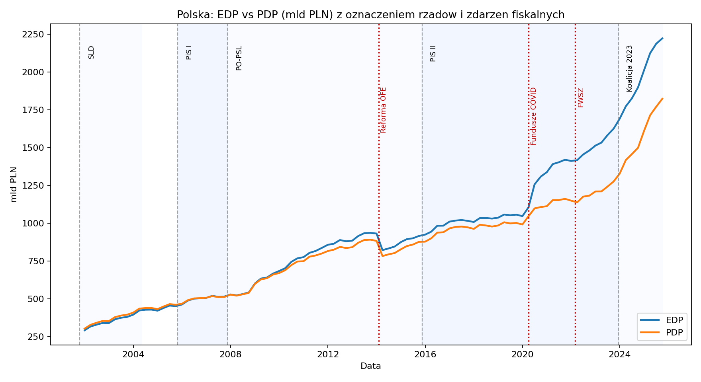
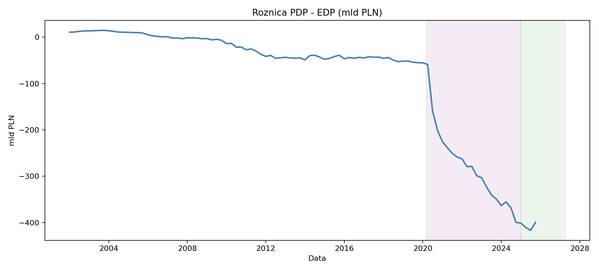

---
title: "Ile naprawdę wynosi polski dług publiczny?"
subtitle: "PDP, EDP i historia dwóch miar zadłużenia"
description: "Dwie oficjalne miary długu, zmienna luka i granice porównań między okresami rządów."
lang: pl
format:
  html:
    toc: true
    number-sections: true
execute:
  echo: false
  warning: false
  message: false
---

O polskim długu publicznym można usłyszeć dwie różne liczby — i obie mogą pochodzić z oficjalnych statystyk. Różnica nie musi oznaczać błędu: **PDP i EDP opisują zadłużenie według innych zasad**. Zanim zapytamy, czy dług rośnie, musimy ustalić, co mierzymy.

Ta historia obejmuje zapisany zbiór kwartalny od końca 2001 r. do końca III kwartału 2025 r. To zakres tego wydania raportu, a nie deklaracja aktualnego stanu zadłużenia.

```{python}
from pathlib import Path
import pandas as pd
from IPython.display import Markdown, display

story_root = Path.cwd().parent
processed = story_root / "data" / "processed"

debt_q = pd.read_csv(processed / "debt_quarterly.csv", parse_dates=["date"])
latest = pd.read_csv(processed / "debt_latest_snapshot.csv", parse_dates=["date"])
gov_growth = pd.read_csv(processed / "debt_growth_by_government.csv", parse_dates=["start_date", "end_date"])
event_slopes = pd.read_csv(processed / "debt_event_slopes.csv", parse_dates=["event_date"])
last = latest.sort_values("date").iloc[-1]
assert debt_q["date"].is_unique
assert debt_q[["edp_bn", "pdp_bn", "edp_pct_gdp", "pdp_pct_gdp"]].notna().all().all()
assert last["date"] == debt_q["date"].max()
for column in ["edp_bn", "pdp_bn", "edp_pct_gdp", "pdp_pct_gdp"]:
    assert abs(float(last[column]) - float(debt_q.sort_values("date").iloc[-1][column])) < 1e-6

def pl(value):
    return f"{float(value):,.1f}".replace(",", " ").replace(".", ",")

def table(headers, rows):
    display(Markdown("| " + " | ".join(headers) + " |\n| " + " | ".join(["---"] * len(headers)) + " |\n" + "\n".join("| " + " | ".join(map(str, row)) + " |" for row in rows)))
```

## Dwie miary, dwie odpowiedzi

```{python}
gap = float(last["edp_bn"] - last["pdp_bn"])
gap_pp = float(last["edp_pct_gdp"] - last["pdp_pct_gdp"])
display(Markdown(f"Na **{last['date'].strftime('%d.%m.%Y')}** państwowy dług publiczny (PDP) wynosił **{pl(last['pdp_bn'])} mld zł**, a dług EDP — **{pl(last['edp_bn'])} mld zł**. Różnica wynosiła **{pl(gap)} mld zł**."))
table(["Miara", "mld zł", "% PKB"], [
    ["PDP — definicja krajowa", pl(last["pdp_bn"]), pl(last["pdp_pct_gdp"])],
    ["EDP — definicja unijna", pl(last["edp_bn"]), pl(last["edp_pct_gdp"])],
    ["Różnica EDP − PDP", pl(gap), f"{pl(gap_pp)} pkt proc."],
])
```

To dwa opisy tego samego momentu według odmiennych reguł. Kwota bez nazwy miary nie wystarcza do rzetelnego porównania. Trzeba też odróżnić nominalną wartość długu od relacji do PKB: wzrost pierwszej nie musi oznaczać wzrostu drugiej.

## Skąd bierze się różnica?

**PDP** opisuje zadłużenie sektora finansów publicznych według definicji krajowej, po konsolidacji, czyli wyeliminowaniu wzajemnych zobowiązań w sektorze. **EDP** obejmuje dług sektora instytucji rządowych i samorządowych według reguł unijnych. Zakres jednostek i reguły ujmowania zobowiązań nie są identyczne.

Ministerstwo Finansów przedstawia uzgodnienie obu miar, uwzględniając m.in. zobowiązania funduszy w BGK, finansowanie PFR oraz korekty konsolidacji i wyceny. Z samej różnicy dwóch szeregów nie można odczytać udziału każdego składnika. Ten raport opisuje rozmiar luki, ale nie rozkłada jej na instytucje. [Źródło: Ministerstwo Finansów](https://www.gov.pl/web/finanse/zadluzenie-sektora-finansow-publicznych).

## Ta różnica nie zawsze była tak duża {#teza-1-edp-vs-pdp}



Obie miary pokazują długookresowy wzrost nominalnego zadłużenia, lecz po 2019 r. ich rozbieżność staje się wyraźniejsza. Oznaczenia rządów i wydarzeń pomagają zlokalizować zmiany w czasie; same nie wyjaśniają ich przyczyn.

```{python}
year_ends = debt_q[debt_q["date"].dt.month.eq(12)].sort_values("date")
selected = year_ends[year_ends["date"].dt.year.isin([2019, 2020, 2023, 2024])]
table(["Koniec roku", "EDP (mld zł)", "PDP (mld zł)", "EDP − PDP (mld zł)"], [
    [int(row.date.year), pl(row.edp_bn), pl(row.pdp_bn), pl(row.edp_bn - row.pdp_bn)]
    for row in selected.itertuples()
])
pre = year_ends[year_ends["date"].dt.year.eq(2019)].iloc[0]
covid = year_ends[year_ends["date"].dt.year.eq(2020)].iloc[0]
display(Markdown(f"Na koniec 2019 r. luka wynosiła **{pl(pre.edp_bn - pre.pdp_bn)} mld zł**. Rok później było to **{pl(covid.edp_bn - covid.pdp_bn)} mld zł**. W 2020 r. nominalny EDP wzrósł o **{pl(covid.edp_bn - pre.edp_bn)} mld zł**, a PDP o **{pl(covid.pdp_bn - pre.pdp_bn)} mld zł**. Wybór definicji zmieniał więc nie tylko poziom długu, ale także obraz jego przyrostu."))
```



**Uwaga na znak:** wykres zachowuje konwencję źródłowej tabeli, czyli **PDP − EDP**. Im niżej jest linia poniżej zera, tym większa przewaga EDP nad PDP. W tekście i tabelach pokazujemy tę samą lukę jako EDP − PDP, aby jej rozmiar był dodatni.

Luka nie rośnie w każdym kwartale. Pod koniec 2024 r. wynosiła 401,1 mld zł, a na koniec III kwartału 2025 r. — 399,4 mld zł. Trend wieloletni nie oznacza więc jednostajnego przebiegu zmian.

## Kiedy zmieniało się tempo wzrostu?

Pandemia, reforma OFE i utworzenie Funduszu Wsparcia Sił Zbrojnych (FWSZ) stanowią punkty odniesienia dla chronologii. Tabela porównuje nominalne tempo zmiany EDP w oknach dwóch lat przed i dwóch lat po wskazanej dacie.

```{python}
table(["Punkt odniesienia", "Data umowna", "Przed (mld zł/rok)", "Po (mld zł/rok)"], [
    [row.event, row.event_date.strftime("%d.%m.%Y"), pl(row.slope_before_bn_per_year), pl(row.slope_after_bn_per_year)]
    for row in event_slopes.itertuples()
])
```

W oknach wokół kwietnia 2020 r. tempo wzrostu EDP zwiększa się z około 40,2 do 91,3 mld zł rocznie. Wokół marca 2022 r. porównanie daje natomiast spadek ze 175,0 do 157,0 mld zł rocznie. Wybrane wydarzenie nie oznacza automatycznie przyspieszenia w takim zestawieniu.

Tempo obliczono ze zmiany między pierwszą a ostatnią obserwacją w oknie, przeliczonej na rok. Nie jest to wynik regresji ani oszacowanie wpływu wydarzenia. Okna obejmują inne zdarzenia i częściowo się nakładają. Daty służą orientacji, a nie szczegółowej analizie momentu wejścia regulacji w życie.

## Jak wyglądały kolejne okresy rządów?

Podział według rządów porządkuje historię. Długość okresów jest różna, dlatego obok całkowitego przyrostu pokazujemy zmianę przeliczoną na rok.

```{python}
growth = gov_growth[gov_growth["government"].ne("Poza okresami")].sort_values("start_date")
table(["Okres", "Pierwsza obserwacja", "Ostatnia obserwacja", "Zmiana EDP (mld zł)", "Średnio (mld zł/rok)"], [
    [row.government, row.start_date.strftime("%d.%m.%Y"), row.end_date.strftime("%d.%m.%Y"), pl(row.change_edp_bn), pl(row.avg_growth_edp_bn_per_year)]
    for row in growth.itertuples()
])
```

W zapisanym zbiorze średni nominalny przyrost EDP wynosi około 49,9 mld zł rocznie w okresie PO–PSL i 90,4 mld zł rocznie w okresie PiS II. Dla obserwacji od końca 2023 r. do końca III kwartału 2025 r. wynosi 303,2 mld zł rocznie. Ostatni wynik opisuje krótki, niezakończony okres i nie jest prognozą na całą kadencję.

**To opis chronologiczny, a nie ranking odpowiedzialności rządów.** Na zadłużenie wpływają również cykl gospodarczy, inflacja, pandemia, wydatki obronne, koszty finansowania i zmiany klasyfikacji. Nominalne złote z początku i końca badania mają inną siłę nabywczą. Bez uwzględnienia tych czynników tabela nie wyjaśnia przyczyn zmian ani obciążenia gospodarki.

Daty w tabeli to pierwsza i ostatnia kwartalna obserwacja przypisana do okresu, nie dokładne granice rządu. Zmiana między nimi pomija przyrost od poprzedniego kwartału do pierwszej obserwacji okresu. Zestawienie nie obejmuje wszystkich gabinetów: etykieta „Poza okresami” w danych oznacza obserwacje nieprzypisane w obecnym podziale.

## Jak czytać liczbę opisującą dług?

Odpowiedź na pytanie „ile wynosi polski dług publiczny?” wymaga wskazania **miary, daty i jednostki**. Na koniec III kwartału 2025 r. różnica między EDP a PDP wynosiła w tym zbiorze 399,4 mld zł. Nie można jej pominąć przy porównywaniu poziomów ani przyrostów zadłużenia.

1. **Porównuj tę samą definicję:** PDP z PDP lub EDP z EDP.
2. **Sprawdzaj daty:** stan na koniec kwartału nie jest średnią roczną, a krótki okres nie jest pełną kadencją.
3. **Rozróżniaj kwotę i relację do PKB:** nominalny przyrost i obciążenie gospodarki odpowiadają na różne pytania.
4. **Oddzielaj opis od przyczyn:** wykres z datami wydarzeń dostarcza kontekstu, ale nie dowodu przyczynowego.

Te dane pokazują różnice między miarami i ich dynamikę. Nie pozwalają ustalić, jak często debata publiczna miesza definicje, ani przypisać całości przyrostu długu decyzjom konkretnego rządu.

## Dlaczego nie pokazujemy wykresu Banku Światowego?

W zapisanym pliku wskaźnika **`DT.DOD.DECT.CD`** występuje wiersz Polski (`POL`), lecz wszystkie **65 kolumn rocznych** są puste. Nie ma więc obserwacji, z których można narysować szereg. Wcześniejszy obraz zawierał tylko komunikat o braku danych; usunięto go wraz z pustą tabelą. **Brak wartości nie oznacza zerowego zadłużenia** ani braku danych o Polsce we wszystkich zbiorach Banku Światowego.

Dług zewnętrzny dotyczy zobowiązań rezydentów wobec nierezydentów i może obejmować sektor prywatny. Nie jest trzecią, zamienną miarą PDP lub EDP. Dlatego nie wykorzystujemy go do porównania poziomu długu publicznego. [Wyjaśnienie Banku Światowego](https://datahelpdesk.worldbank.org/knowledgebase/articles/826488-what-is-the-difference-between-external-debt-stoc).

## Źródła i zakres analizy {.unnumbered}

- **Dług publiczny:** zapisany plik `data/raw/dlug_publiczny.xlsx`, przetworzony do 96 obserwacji kwartalnych, 31.12.2001–30.09.2025. Oficjalne [szeregi Ministerstwa Finansów](https://www.gov.pl/web/finanse/szeregiczasowe) zawierają również nowsze wydania. W tej redakcji nie aktualizowano danych ani nie mieszano wydań.
- **Obliczenia:** `scripts/01_build_debt_story_data.py`, tabele w `data/processed/`. Kwoty: mld zł, jedno miejsce po przecinku; różnica relacji do PKB: punkty procentowe.
- **Kontrola WB:** zapisany CSV `API_DT.DOD.DECT.CD_DS2_en_csv_v2_976.csv`, wskaźnik [External debt stocks, total (DOD, current US$)](https://data.worldbank.org/indicator/DT.DOD.DECT.CD). Wiersz `POL`: 0 wartości liczbowych w 65 kolumnach rocznych. Seria nie jest podstawą wniosków ilościowych.

Nie analizujemy tu kosztów obsługi długu, zapadalności ani pełnego uzgodnienia składników luki EDP–PDP. To historia o porównywalności liczb, a nie kompletna ocena stabilności finansów publicznych.
